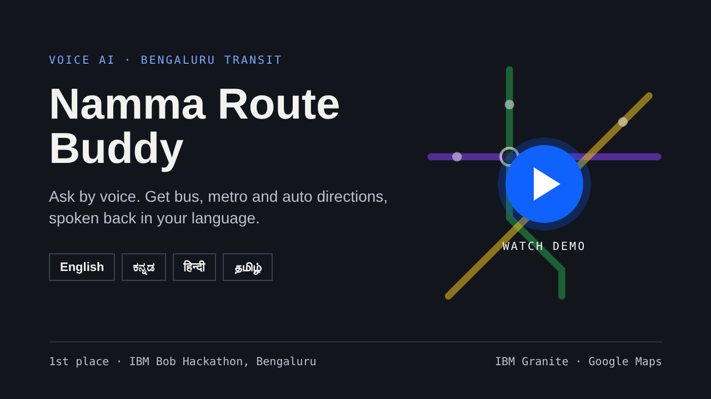

# Namma Route Buddy

A voice-first transit guide for Bengaluru. Ask in English, Kannada, Hindi or Tamil and get step-by-step bus, metro and auto directions, read aloud in your language.

[](https://youtu.be/hOUCWMeTD_w)

Built in 4 hours at the **IBM Bob Hackathon, Bengaluru (Nov 2026)**, where it won **1st place**. 

## Features

- Ask by voice or text in English, Kannada, Hindi or Tamil
- City-wide routes using Google Maps transit data (BMTC buses, Namma Metro, walking)
- Fastest and cheapest options, plus a direct auto/cab estimate
- Step-by-step directions spoken back in the selected language
- Offline fallback: metro-only routing and rule-based replies

## How it works

```
Voice / text
   → IBM Granite (via Ollama): understands the question
   → Google Maps Routes API: finds bus and metro options
     (fallback: built-in offline metro graph)
   → IBM Granite: writes the directions in the user's language
   → Browser speaks the reply
```

The model never invents routes or fares. It only understands the question and phrases the answer from real route data.

## A note on the model

This prototype deliberately uses a **small, lightweight model**: IBM Granite 3.3 (2B) running locally through Ollama. No frontier or cloud LLMs are used. This keeps it free to run, private and usable on a normal laptop, at the cost of some answer quality (see Limitations).

## Getting started

**Prerequisites**
- Python 3.10+
- [Ollama](https://ollama.com) with `ollama pull granite3.3:2b`
- Google Cloud project with **Routes API** and **Places API (New)** enabled, and a restricted API key (optional; without it the app uses offline metro routing)

**Setup**
```bash
git clone <repo-url>
cd namma-route-buddy
python -m venv venv
source venv/bin/activate
pip install -r requirements.txt
cp .env.example .env      # add your GOOGLE_MAPS_API_KEY
```

**Run**
```bash
uvicorn app.main:app --reload --reload-dir app --reload-dir web
```
Open http://localhost:8000 in Chrome (needed for voice input).

## Limitations

This is an early prototype and there is a lot to improve:

- **Small model:** Kannada and Tamil replies can be less natural than English or Hindi, and follow-up questions are sometimes misunderstood.
- **Voice input:** relies on the browser's speech recognition. Place names spoken in Kannada or Tamil script are not always matched correctly; English place names work best.
- **Fares:** come from Google Maps where available; auto and cab fares are rough estimates.
- **No live data:** no real-time bus or metro arrivals yet.
- **Offline mode** covers only the metro network and a limited set of areas.
- **Speech output** depends on the voices installed on your device; Kannada and Tamil voices may be missing.
- Tested mainly in Chrome on desktop.

## Roadmap

- Live bus and metro arrivals
- Better multilingual place-name matching
- More Indian languages
- WhatsApp / phone (IVR) access for feature phones

## Project structure

```
app/        FastAPI backend (api, services, route engines, LLM clients)
web/        Frontend (HTML, CSS, JS, voice)
data/       Offline metro network and area data
tests/      Route evaluation script
docs/       Screenshots
```

## Credits

- Built with **IBM Bob**
- Language model: **IBM Granite** via Ollama
- Routes: **Google Maps Platform**